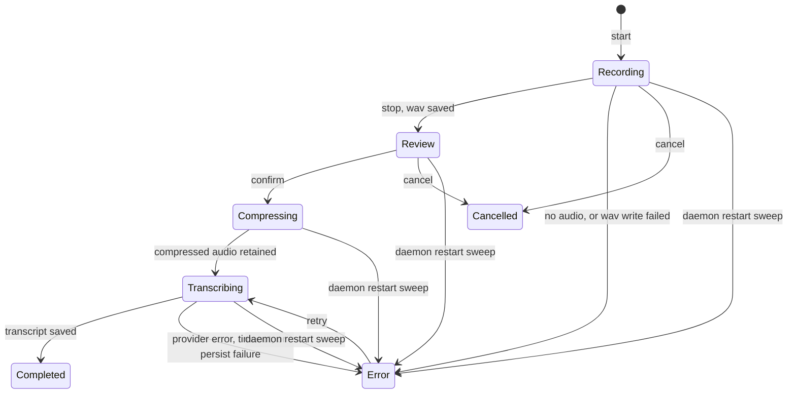
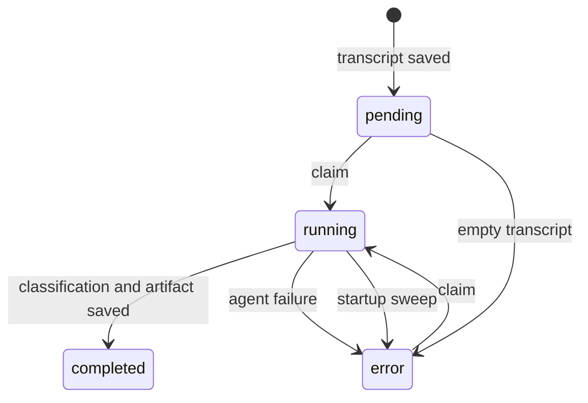
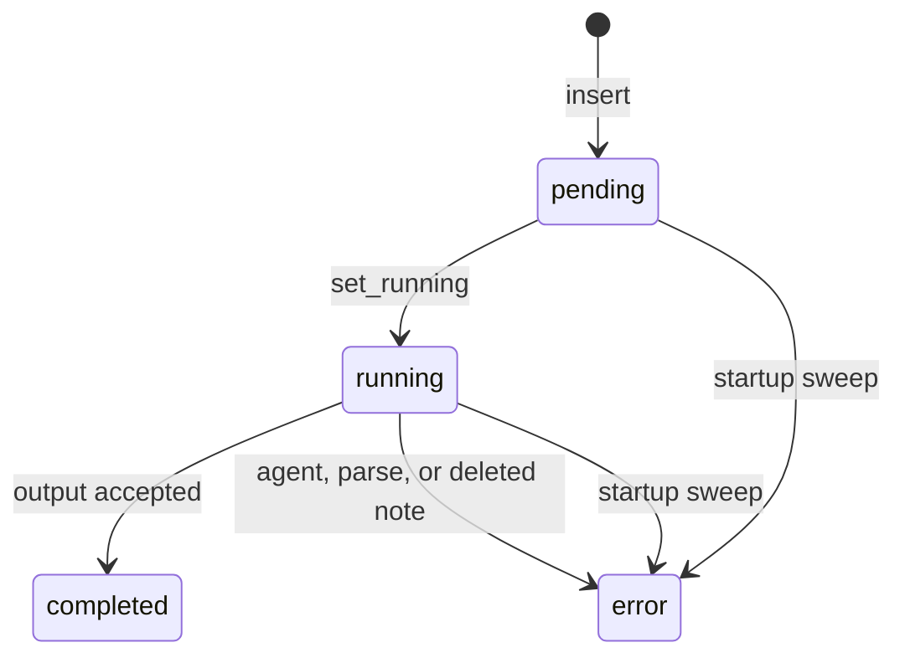
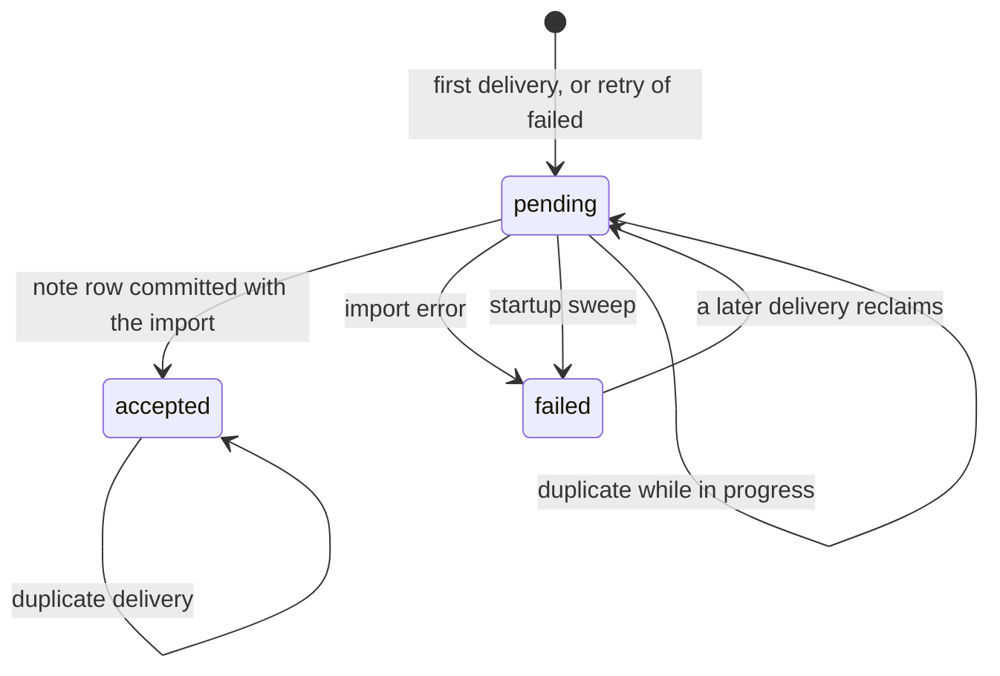

# Explicit state machines

Status: Proposed

This is an inventory, not a behavior change. Implicit lifecycles in the daemon
(`crates/audetic`) and the web UI (`apps/web-ui`) should become closed sets:
a Rust enum, one transition function, and exhaustive `match`es on the daemon;
a TypeScript discriminated union generated from the OpenAPI schema, branched
with `assertNever`, in the UI.

Effect-TS and XState are out of scope for the whole app. No lifecycle below
has cancel, retry, and timeout racing each other in a way that a statechart
library would pay for. The one place to revisit that limit is named at the
end.

Language follows `crates/audetic/src/audio_notes/CONTEXT.md` and
`crates/audetic/src/audio/CONTEXT.md`. Degraded Capture stays a condition of
an in-progress recording, as ADR 0002 decided. It is not a sibling phase.

## Already closed

These are enums on both sides of the HTTP boundary. Leave them. New work
should copy their shape (`#[serde(tag = ...)]` or `rename_all`, `ToSchema`,
generated union in `apps/web-ui/src/api/schema.ts`):

| Type | Where |
|---|---|
| `ProviderStatus` | `crates/audetic/src/transcription/mod.rs:155`, schema union |
| `SetupState`, `SetupCapabilityId` | `crates/audetic-core/src/setup.rs:11` |
| `InstallPhase` | `crates/audetic/src/api/routes/system.rs:62` |
| `KeybindStatus` | `crates/audetic/src/keybind/mod.rs:118` |
| `DownloadProgress` | `crates/audetic/src/transcription/models.rs:45` |
| `AudioNoteTitleSource` | `crates/audetic/src/api/routes/audio_notes.rs:297` |
| `ArtifactStatus` | `crates/audetic/src/db/audio_note_artifacts.rs:10` (wire enum; DB writes are not closed — see below) |

`AudioNotePhase` (`crates/audetic/src/audio_notes/status.rs:13`) is a closed
Rust enum, and the capture command loop applies one command at a time
(`crates/audetic/src/app/mod.rs:224`). The row, the HTTP snapshot, and the UI
do not share that enum. That gap is the first lifecycle below.

There is no `assertNever` in `apps/web-ui` today. Unknown strings fall
through to a label, a spinner, or silence.

## 1. Audio Note status

Two clocks describe one capture.

**Live clock.** `AudioNoteStatusHandle` holds `AudioNoteState.phase:
AudioNotePhase` (`status.rs:90`). Values: `idle`, `recording`, `review`,
`compressing`, `transcribing`, `completed`, `error`, `cancelled`
(`status.rs:29`). `idle` means "no current note". It is not stored. `active`
on `GET /audio-notes/status` is `phase == Recording` (`api/routes/audio_notes.rs:751`),
so Review is active to the UI only because the UI checks the string itself.

**Durable clock.** `audio_notes.status` is `TEXT NOT NULL DEFAULT 'recording'`
with no `CHECK` (`db/migrations/0001_baseline.sql:5`). The repository stores
`phase.as_str()` (`db/audio_notes.rs:135`). HTTP exposes both clocks as
`string` (`AudioNoteStatusResponse.phase` at `api/routes/audio_notes.rs:198`,
`AudioNoteSummary.status` at `:224`). `schema.ts` repeats `phase: string`
(around line 1242) and `status: string` (around line 1157).



Import skips Recording and Review. The row is inserted at the table default
`recording`, then overwritten to `compressing` before the pipeline starts
(`audio_notes/import.rs:222` and `:243`).

### Transitions

| From | To | Trigger | Where |
|---|---|---|---|
| (none) | `recording` | `start` inserts the row (SQL default) and sets the handle | `audio_note_machine.rs:158`, `status.rs:187` |
| `recording` | `error` | both sources fail to open | `audio_note_machine.rs:198` |
| `recording` | `error` | stop finds no samples | `audio_note_machine.rs:393`, `db/audio_notes.rs:345` |
| `recording` | `error` | wav write fails | `audio_note_machine.rs:424` |
| `recording` | `review` | stop saved the wav | `db/audio_notes.rs:143`, `status.rs:230`, `audio_note_machine.rs:435` |
| `review` | `compressing` | confirm, including auto-confirm when review is off | `audio_note_machine.rs:445`, `:512`; DB write lags until `processing.rs:147` |
| `compressing` | `transcribing` | upload file is ready | `processing.rs:177` |
| `transcribing` | `completed` | transcript persisted; also forces enrichment back to `pending` | `db/audio_notes.rs:335`, `progress.rs:86` |
| (in flight) | `error` | pipeline `Err` | `processing.rs:124`, `progress.rs:69` |
| `recording` or `review` | `cancelled`, then live `idle` | cancel | `audio_note_machine.rs:544`, `db/audio_notes.rs:350`, `status.rs:274` then `:245` |
| `error` | `transcribing` | retry, compare-and-swap | `db/audio_notes.rs:361`, `api/routes/audio_notes.rs:1349` |
| any non-terminal | `error` | startup sweep | `db/audio_notes.rs:355`, called from `app/mod.rs:148` |

`toggle` starts from every phase except `recording` (which stops) and
`review` (which bails). The `review` arm is the wildcard `phase =>` at
`audio_note_machine.rs:611`, so a new phase becomes "cannot toggle" only if
nobody adds it to the start arm first.

The handle setters `set_phase` (`status.rs:211`), `set_error` (`:238`),
`complete` (`:268`), `cancelled` (`:274`), and `reset` (`:245`) do not check
the current phase. `progress_if_current`
(`status.rs:166`) checks the note id and ignores a stale pipeline, which is
the right guard for the live clock, and it still accepts any destination
phase. `update_status`, `set_review`, `complete`, `fail`, and `cancel` update
the row with no expected-from predicate (`db/audio_notes.rs:135`, `:143`,
`:335`, `:345`, `:350`). `begin_retry` is the one capture transition that
does (`:361`).

### Branches and silent fallthrough

Daemon matches on `AudioNotePhase` are exhaustive except the toggle wildcard
above. SQL and the HTTP types are not.

UI string checks, all of which ignore a phase they do not list:

- Live capture: `command-bar.tsx:29` (`recording` / `review` / `compressing` /
  `transcribing`). `error`, `cancelled`, and anything new render as idle
  unless `lastError` is set (`:35`).
- `capture-controls.tsx:28` treats only `active` or `phase === "review"` as
  busy. A new in-flight phase would leave the Record button enabled.
- Poll interval is 1s while `active` or `review`, otherwise 4s
  (`stores/audio-notes-store.ts:312`). Compressing and transcribing already
  poll slowly; a new phase would too.
- Row and detail copy: `routes/audio-notes.tsx:165`,
  `routes/audio-note-detail.tsx:99`. Any status other than `completed`,
  `error`, `cancelled`, `recording`, and `review` becomes "Processing audio…"
  or `kindLabel(status)` (`lib/audio-notes.ts:23`), which prints the raw
  token with punctuation removed.
- `noteNeedsRefresh` (`lib/audio-notes.ts:24`) treats every status outside
  `completed | error | cancelled` as in flight. A new terminal status would
  keep the 2s detail poll running (`routes/audio-note-detail.tsx:51`).

### Invalid combinations

- The row can hold any string, including `idle`, which the sweep would then
  treat as interrupted because it is not in `TERMINAL_STATUSES`
  (`status.rs:50`).
- `status = completed` with a null transcript, and `status = error` with a
  transcript left from an earlier attempt. `complete` and `fail` do not
  share a column invariant.
- Live `compressing` while the row is still `review`, for the interval
  between `set_phase` (`audio_note_machine.rs:512`) and the pipeline's
  `update_status` (`processing.rs:147`).
- After cancel, the row is `cancelled` and the handle is `idle`
  (`audio_note_machine.rs:577`). Clients that read only the live snapshot
  never observe `cancelled`.
- Startup sweep turns Review into `error` and does not resume it. The wav
  can still be on disk, but `confirm` requires the in-memory Review phase
  (`audio_note_machine.rs:471`). That is a real gap, not an accident of
  wording. A later change can add a resume transition; this inventory does
  not decide that product behavior.
- `capture_degraded` is derived and cleared whenever the phase leaves
  Recording (`status.rs:139`). The three private bools
  (`microphone_capturing`, `system_capturing`, `system_expected`) cannot be
  seen off Recording. Good. `CaptureState` (`Both` / `MicOnly` /
  `SystemOnly`, `audio_note_machine.rs:35`) is a different fact: which
  sources came up at start. It is returned once, as `capture_state: string`
  (`api/routes/audio_notes.rs:160`), and the UI never branches on it.

Frontend and backend agree on the eight spellings only by convention.
`AudioNotePhase` is not the schema type.

## 2. Enrichment

**Where.** `audio_notes.enrichment_status TEXT NOT NULL DEFAULT 'pending'
CHECK (... IN ('pending', 'running', 'completed', 'error'))`
(`0001_baseline.sql:26`). Rust stores a `String`
(`db/audio_notes.rs:41`). `set_enrichment_state` repeats the same four
literals (`:242`). HTTP and `schema.ts` type it as `string`
(`api/routes/audio_notes.rs:216`, schema around line 1148).



| From | To | Trigger | Where |
|---|---|---|---|
| (any, on that row) | `pending` | transcript `complete` clears error too | `db/audio_notes.rs:336` |
| `pending` or `error` | `running` | `claim_enrichment`, requires `status = completed` and a non-blank transcript | `db/audio_notes.rs:255` |
| not `running` or `completed` | `error` | blank transcript before claim | `note_intelligence/mod.rs:62` |
| `running` | `completed` | after classification and the processor artifact | `note_intelligence/mod.rs:88` |
| `running` | `error` | any later `Err`, unconditional write | `note_intelligence/mod.rs:110` |
| `running` | `error` | startup sweep | `db/audio_notes.rs:269`, `app/mod.rs:149` |
| `running` or `completed` | (stay) | second `enrich_audio_note` returns without writing | `note_intelligence/mod.rs:59` |

`POST /audio-notes/:id/process` checks `pending` or `error` and returns 202
before the claim (`api/routes/audio_notes.rs:438`). Two requests can both
pass the check; the claim makes the second a no-op. The UI latch
`processing[id]` covers only the HTTP call (`stores/audio-notes-store.ts:235`)
and is cleared in `finally` before the agent finishes, so the button uses
`enrichment_status === "running"` as well (`components/note-enrichment.tsx:30`).

UI branches: `enrichmentLabel` (`lib/audio-notes.ts:27`) has a `default` of
"AI status unknown". `note-enrichment.tsx:22` treats only `pending` and
`running` as busy. A new status would show the Process button (the button
hides only for `completed`) and would not spin.

### PR #78 does not add a status value

[PR #78](https://github.com/silvabyte/Audetic/pull/78)
(`cursor/disable-automatic-ai-processing-7654`) keeps the four-value `CHECK`.
Migration `0003_enrichment_skipped.sql` adds `enrichment_skipped INTEGER NOT
NULL DEFAULT 0`. "Skipped" is the combination `enrichment_status = 'pending'`
AND `enrichment_skipped = 1`.

On that branch:

- After the transcript is saved, if `[behavior.ai_processing] enabled` is
  false, `process_audio_note` calls `mark_enrichment_skipped` instead of
  spawning enrichment (`audio_notes/processing.rs:128` on the branch).
- The mark updates only `completed` + `pending` rows
  (`db/audio_notes.rs:276` on the branch).
- `claim_enrichment` sets `enrichment_skipped = 0` as it moves to `running`
  (`db/audio_notes.rs:262` on the branch), so manual Process still works.
- `set_enrichment_state` still rejects any status other than the original
  four. `complete()` still writes `pending` and does not clear the flag.
- The UI defines skipped as the boolean AND `pending`
  (`apps/web-ui/src/lib/audio-notes.ts:25` on the branch) and then hides the
  pending label and stops polling.

That combination is legal in SQLite for every status, not only `pending`:
nothing checks `enrichment_skipped = 0` when status is `running`,
`completed`, or `error`. `complete()` resetting status to `pending` without
clearing the flag means a later transcription retry of a row that had been
skipped would still look skipped while a new job is eligible to start. The
retry path today only runs from `status = error`, so this is latent, and it
is the sort of combination a single column cannot express.

Frontend and backend agree on `pending | running | completed | error`. They
do not agree on a `skipped` status, because that value does not exist. The
UI on the branch invents it from two columns.

## 3. Degraded Capture

Not a phase. ADR 0002: a recording stays alive while a required device is
down. `CaptureRecovery` is already `Ignored | Capturing | Degraded`
(`audio/capture_recovery.rs:10`). The handle applies it only while
`phase == Recording` (`status.rs:282`, `:295`, `:304`, `:317`). Device
switches and stream deaths enter the same command loop as start and stop
(`app/mod.rs:226`).

Do not add a `degraded` Audio Note status. If the live phase becomes a
struct enum, degradation is data on `Recording` only, so it cannot be set
on Review or Completed.

## 4. Transcription jobs

The Audio Note pipeline calls `TranscriptionJobService::submit_and_poll`
(`processing.rs:184`). Two implementations, neither persisted.

**Remote jobs** (`audetic-core` `jobs_client.rs:102`): `pending`,
`extracting_audio`, `transcribing`, `completed`, `failed`, `cancelled`.
`RemoteTranscriptionJobService` matches the three terminal constants and
uses `_` for everything else, including the three in-progress constants and
any unknown value (`transcription/job_service.rs:87`). Unknown therefore
means "still running" until `timeout` (default constructed by the caller;
the poll interval is 2s, `:49`). On timeout the function returns `Err`
(`:123`) and the note becomes `error`. The remote job is not cancelled.

**AssemblyAI**, used by the local provider path's sibling, has its own
closed enum `queued | processing | completed | error`
(`transcription/providers/assembly_api.rs:37`) and an exhaustive match
(`:225`). Timeout is 120 attempts, 3s apart (`:188`). Same abandonment:
the function returns an error and does not cancel the vendor job.

**Local engine** (`LocalTranscriptionJobService`, `job_service.rs:144`) has
no job status. It transcribes in one call.

The UI never sees these strings. It sees the Audio Note phase. A new remote
status would be polled until timeout and then surfaced as a note `error`,
with no distinction from a genuine `failed`.

This poll-versus-timeout is the concurrency candidate. It is still one
future and a deadline. A cancel token is enough if we later need to abandon
the wait. A library is not justified unless a product requirement adds
user-cancel that races poll completion, vendor cancel, and daemon shutdown
in this module only. See the plan.

## 5. Delivery and automatic paste

Not a stored lifecycle. `AudioNoteDeliveryOptions { auto_paste,
copy_to_clipboard }` is copied onto the pipeline at spawn
(`audio_note_machine.rs:528`). `DesktopDelivery::deliver`
(`processing.rs:43`) returns immediately when both flags are false,
otherwise copies and/or injects. Failure is a `warn` after the transcript
is already saved (`processing.rs:102`). The note stays `completed`. The UI
cannot tell paste failed.

The saved preference is separate: `[behavior.auto_paste]` loaded through
`GET/PUT /audio-notes/settings`. The UI store is its own machine (section
9). Until that load succeeds, browser captures force automatic paste off
(`stores/audio-note-settings-store.ts:27`, `routes/settings/capture.tsx:38`).

`InjectionMethod` (`text_io/mod.rs:275`) chooses how a paste is performed.
It is an implementation switch, not user-visible state.

## 6. Agent runs and artifacts

An agent run has no table. `run_agent` (`agents/mod.rs:73`) waits with one
timeout and `kill_on_drop`. The result is `success: bool`, `exit_code:
Option<i32>`, `timed_out: bool`. Those three can disagree (`success` with a
signal and no code; the timeout arm sets `success: false` and `timed_out:
true`). `checked_output` (`audio_note_artifacts/mod.rs:209`) turns timeout,
non-zero exit, and empty stdout into `Err`.

`run_with_timeout` (`audio_note_artifacts/mod.rs:224`) wraps that wait in a
second timeout of the same `timeout_seconds` (600, `:274`). If the inner
wait hangs past the deadline, the outer one wins and the artifact fails
with a different error string than `timed_out`. One timeout is enough.
This is not a statechart.

The durable machine is the artifact row. `audio_note_artifacts.status` is
unconstrained `TEXT` (`0001_baseline.sql:106`). Rust and OpenAPI already
share `pending | running | completed | error` (`db/audio_note_artifacts.rs:10`,
schema `ArtifactStatus`).



Writes do not require the previous status (`db/audio_note_artifacts.rs:75`,
`:115`, `:124`). `generate_with_runner` inserts `pending` and sets `running`
in one transaction (`audio_note_artifacts/mod.rs:84`), so `pending` is not
visible for that path unless the process dies between them. The startup
sweep maps both to `error` (`db/audio_note_artifacts.rs:84`,
`app/mod.rs:150`). A direct SQL update can mark a `completed` row `error`
or the reverse. The UI treats `pending` or `running` as generating
(`components/note-artifacts-panel.tsx:52`, `routes/audio-note-detail.tsx:56`)
and prints any other non-`completed` status as its raw token
(`note-artifacts-panel.tsx:81`). `generatingByNote` is a second bool for
the HTTP call only (`stores/note-artifacts-store.ts:16`).

Post-processing jobs (`post_processing_jobs`) are configuration: `enabled`
plus an action. `dispatch` spawns one task per job and logs the outcome
(`post_processing/runner.rs:39`). There is no run row. The enrichment
module already documents that a crash between commit and dispatch drops
`audio_note.completed` (`note_intelligence/mod.rs:22`). A run history would
be a new feature, not a refactor of an existing machine. Each command has
its own timeout (`post_processing/executors/command.rs:69`). That is the
same single-future pattern as the agent, not a reason for XState.

## 7. Ingress and recording-source sync

**External import.** `external_imports.status` is checked:
`pending | accepted | failed` (`0001_baseline.sql:57`). The struct field is
`String` (`db/integrations.rs:22`). OpenAPI types it as `string`
(schema `ExternalImportInfo.status`). `ImportClaim` (`db/integrations.rs:33`)
is the result of a claim, not the stored status.



| From | To | Trigger | Where |
|---|---|---|---|
| (none) | `pending` | insert | `db/integrations.rs:177` |
| `failed` (any non-accepted, non-pending) | `pending` | reclaim, clears note id and error | `:165` |
| `accepted` | (stay) | duplicate | `:156` |
| `pending` | (stay, `InProgress`) | duplicate while claimed | `:162` |
| `pending` | `accepted` | note insert commits in the same transaction | `:196`, `audio_notes/import.rs:252` |
| `pending` | `failed` | `fail_external_import` | `:214` |
| `pending` | `failed` | startup sweep of every pending row | `:358`, `integrations/mod.rs:179` |

`accept` checks the row count. `fail` does not (`:214`), so failing a row
that is already `accepted` is a silent no-op. `accepted` with a null
`audio_note_id` is representable; the claim path errors if it sees one
(`:160`) rather than forbidding it in the schema. The UI lists `status` as
a string and does not switch on it (`stores/integrations-store.ts` keeps
the payload).

**Recording-source sync** (Plaud is the only implementation).
`recording_sources.running` is `0 | 1`, plus `last_error`
(`db/integrations.rs:47`). That is a phase made of a bool and an optional
string.

| From | To | Trigger | Where |
|---|---|---|---|
| `running = 0` | `running = 1`, error cleared | `start_sync` compare-and-swap | `db/integrations.rs:310` |
| `running = 1` | `running = 0` | `finish_sync`; `last_completed_at` updates only when error is null | `:338` |
| `running = 1` | `running = 0`, interrupted error | startup sweep | `:369` |

`schedule_poll` refuses a second start when the CAS fails
(`integrations/mod.rs:446`). `finish_sync` does not require `running = 1`
and does not carry a generation, so a finish that is persisted late can
clear a newer run's flag and write the older error. A crash between start
and finish sticks `running = 1` until the next process sweep; the 60s
scheduler skips sources that are running (`:489`). The UI polls `running`
every 2s, up to 150 times (`stores/integrations-store.ts:141`).

Frontend and backend agree on the import spellings by the SQL `CHECK` only.
Sync is a bool, and the UI treats `running: true` as the whole in-progress
state (`:59`).

## 8. UI load, save, and polling

These machines exist only in the browser. They should be shared unions in
the UI, not OpenAPI types. The daemon already has the resource on the other
side of the request.

The same four strings are redeclared:

| Store | Representation | Where |
|---|---|---|
| Audio note settings | `"idle" \| "loading" \| "loaded" \| "error"` plus `saving: boolean` | `stores/audio-note-settings-store.ts:17` |
| Audio notes lists and detail | `LoadState`; separate maps for titles (`idle \| saving \| generating \| error`) and classification (`idle \| saving \| error`) | `stores/audio-notes-store.ts:11` |
| Config sections | `Status`, `MutationStatus` (`idle \| loading \| success \| error`), `RestartStatus` | `stores/config-store.ts:20` |
| Setup, integrations, post-processing, artifact prerequisites, meta | the same `idle \| loading \| loaded \| error` | `setup-store.ts:11`, `integrations-store.ts:12`, `post-processing-store.ts:17`, `note-artifacts-store.ts:8`, `meta-store.ts:13` |
| FFmpeg onboarding | `unknown \| checking \| ready \| needs-ffmpeg \| error`, plus `InstallPhase` | `onboarding-store.ts:5` |

`AudioNoteSettingsStore` is the one that can represent a contradiction.
`saving` is orthogonal to `state`. `saveAutoPaste` sets `state = "error"`
when the PUT fails, including when the server may have committed
(`audio-note-settings-store.ts:66`). That is deliberate. `savedAutoPaste`
then returns false because `state !== "loaded"` (`:34`), so the controls
show off until a reload. A single union `loading | loaded | saving | error`
makes `saving` while `idle` unrepresentable. `error` should keep the last
confirmed settings out of the render path, which the current bool does not
quite do: `settings` is left in place while `state` says not to trust it.

Poll loops, and what they treat as terminal:

| Loop | Interval | Stops when | Where |
|---|---|---|---|
| Live capture | 1s if recording or review, else 4s | store `stop()` | `audio-notes-store.ts:312` |
| Note detail | 2s | status in `completed \| error \| cancelled`, enrichment not `pending` or `running`, no generating title, no pending artifact | `audio-note-detail.tsx:51`, `lib/audio-notes.ts:24` |
| Generated title | 2s, 75 times | title becomes non-empty, or the local status leaves `generating` | `audio-notes-store.ts:280` |
| Model download | 1s | `installed`, or download `completed` or `error` | `config-store.ts:129` |
| Plaud sync | 2s, 150 times | `running` is false, or the epoch changes | `integrations-store.ts:141` |
| FFmpeg install | 500ms, 5 min | `InstallPhase` `done` or `error` | `onboarding-store.ts:9`, `:78` |
| Daemon restart | until 15s | `/version` instance id changes | `config-store.ts:484` |

`InstallPhase`, `DownloadProgress`, and the restart union are the models to
copy. The note poll is the one that will mis-classify a new status, because
its terminal set is an allow-list of strings.

## Where the two sides disagree

| Lifecycle | Daemon | HTTP / `schema.ts` | UI |
|---|---|---|---|
| Audio Note phase | `AudioNotePhase` | `string` | string equality, default labels |
| Enrichment | four strings, SQL `CHECK` | `string` | switch with `default` |
| Skipped (PR #78) | bool column, status stays `pending` | bool + `pending` | `flag && pending` |
| Capture source at start | `CaptureState` | `string` | unused |
| Capture source on the note | allow-list in `set_capture_source` (`db/audio_notes.rs:160`), no SQL `CHECK` | `string` | three-way string compare (`routes/audio-notes.tsx:168`) |
| Artifact | `ArtifactStatus` | union | string equality, raw token fallback |
| Remote transcription job | string constants, `_` wildcard | not exposed | not shown |
| External import | SQL `CHECK`, Rust `String` | `string` | not branched |
| Sync | `running` bool + `last_error` | bool | `running` |
| Provider, setup, install, keybind, download | enums | unions | generated unions |

## What a transition function should look like

One function per lifecycle, called by the command loop, the pipeline, and
the repository. Illegal pairs return `Err` and write nothing. The SQL
`UPDATE` includes `AND status = ?expected`. The live handle, when there is
one, updates only if the note id and the expected phase still match
(`progress_if_current` already does the id half).

```rust
fn transition(current: AudioNotePhase, event: AudioNoteEvent) -> Result<AudioNotePhase, IllegalTransition>
```

`AudioNoteEvent` is the closed set of triggers in the table above, including
`Interrupted` for the startup sweep. Review resume is not an event until
someone decides the product should do it.

Enrichment, after PR #78's meaning is folded in:

```rust
enum EnrichmentStatus { Pending, Skipped, Running, Completed, Error }

fn transition(current: EnrichmentStatus, event: EnrichmentEvent) -> Result<EnrichmentStatus, IllegalTransition>
```

`EnrichmentEvent`: `TranscriptSaved { automatic: bool }`, `Claim`,
`Succeeded`, `Failed`, `Interrupted`. `TranscriptSaved { automatic: false }`
goes to `Skipped` from any prior enrichment state, because a new raw
transcript replaces the previous AI result. `Claim` is legal from `Pending`,
`Skipped`, and `Error`, and only when the note status is `Completed` with a
non-blank transcript. That note-status precondition stays a guard on the
claim, not a combined mega-enum: transcription and enrichment are different
lifecycles that happen to share a row. The `CHECK` becomes the five
variants. `enrichment_error` is written only with `Error` and cleared on
every other transition. The `enrichment_skipped` column goes away.

Artifact, import, and sync get the same shape. Sync's event `Finished`
carries the generation returned by `Started`, so a late finish cannot clear
a newer run.

On the UI, codegen produces the union. A helper:

```ts
export function assertNever(value: never): never {
  throw new Error(`Unexpected state: ${JSON.stringify(value)}`);
}
```

Every `switch` on a lifecycle ends in `default: return assertNever(status)`.
`kindLabel` remains for free-form classification kinds. It is the wrong
fallback for a status.

## Prioritized work

Each item is one PR, behavior-preserving except where a PR says it deletes
the skipped flag. No new routes. `audetic_core::url::paths` stays as it is.
The CLI prints daemon JSON and does not match these strings, so it needs no
change. Tests extend the modules that already cover the transition
(`db/audio_notes.rs` tests, `note_intelligence/tests.rs`,
`audio_note_artifacts` tests, `db/integrations.rs` tests,
`apps/web-ui/tests/audio-notes.test.tsx`).

Layering for the daemon PRs: repository method and a forward migration in
`crates/audetic/src/db/` when a `CHECK` or column changes; the transition
function in the domain module (`audio_notes`, `note_intelligence`,
`audio_note_artifacts`, or `integrations`); the `ToSchema` enum on the
response in `api/routes/`; register it only if it is a new component;
`bun run codegen` and commit `schema.ts`; UI `switch` plus `assertNever`.
Nothing in `audetic-core` except the transcription-job PR, which owns
`jobs_client::status`. No `axum` or `clap` in the transition function.

### PR 1. Enrichment status, including Skipped

Highest value, because PR #78 is about to persist the implicit combination
this inventory is trying to avoid. Land it after #78, on top of that
branch's migration.

- Add `skipped` to the `CHECK` via a new migration. Where
  `enrichment_skipped = 1 AND enrichment_status = 'pending'`, set status to
  `skipped`, then drop `enrichment_skipped`.
- Replace `mark_enrichment_skipped` and the stringly `set_enrichment_state`
  with `EnrichmentStatus::transition`.
- `complete()` stops embedding `enrichment_status = 'pending'`. The pipeline
  applies `TranscriptSaved { automatic }` after the transcript commit.
- UI deletes `automaticProcessingSkipped`. `noteNeedsRefresh` does not treat
  `skipped` as in flight. The Process button stays available, matching #78.

Type shape: the enum in the previous section. Wire form is the snake-case
string union, generated into `schema.ts`. Error text stays a sibling column
cleared on non-error transitions, so the schema does not have to become a
struct enum in the same PR.

Risk: a migration that runs against databases that already have #78's
column, and against databases that do not if #78 is absent. Write the
migration for the post-#78 schema only, and do not start this PR until that
column exists.

### PR 2. Publish the Audio Note phase on the wire

Low risk, no transition change. Replace `phase: String`, `status: String`,
and `capture_state: String` with `AudioNotePhase`, the stored subset (no
`idle`), and `CaptureState`. Regenerate `schema.ts`. Point the command bar,
capture controls, list, detail, and `noteNeedsRefresh` at the union and
`assertNever`. `idle` remains handle-only and is omitted from the row
schema.

This PR makes a new phase a compile error in the UI before PR 3 changes
any write.

### PR 3. One Audio Note transition, and compare-and-swap writes

Medium risk: this is the live capture path. `AudioNoteMachine`, import,
retry, and the startup sweep call `transition` instead of `set_phase` /
`update_status` / `complete` / `fail` / `cancel`. Each `UPDATE` requires the
expected current status. `progress_if_current` also requires the expected
phase, not only the note id.

Do not add Review resume here. `Interrupted` keeps today's sweep: every
non-terminal row becomes `error` at startup, including Review.

Verification: existing `audio_notes_integration` tests, plus a unit test
that `complete` from `recording` and `fail` from `completed` change zero
rows. Manual check: record, stop into review, confirm, and see the command
bar move through compressing and transcribing.

### PR 4. Artifact status compare-and-swap, and a SQL `CHECK`

Low risk. The wire enum already exists. Guard `set_running`, `complete`,
and `fail` with the expected status. Add the `CHECK` in a new migration
(existing rows already use the four values; the sweep tests in
`db/audio_note_artifacts.rs` cover the startup map). While editing the
runner, delete the outer `run_with_timeout` only if the inner
`run_agent` timeout still fails the artifact the same way. Do not change
the 600s budget.

### PR 5. External import status enum

Low risk. The `CHECK` already matches the set. Parse into an enum at the
repository boundary, derive `ImportClaim` from `transition`, and make
`fail_external_import` require `pending` the way `accept` already does.
Publish the union on `ExternalImportInfo`. The UI can keep rendering the
label until a screen needs to branch; the type should still be the union
so a new variant fails codegen consumers that switch.

### PR 6. Recording-source sync phase

Smaller value. Replace `running` plus the implied error with `idle |
running | failed`, and return a generation from `start_sync` that
`finish_sync` must echo. The scheduler's "skip if running" becomes a match
on `running`. Startup `Interrupted` stays. The Plaud poll in the UI should
stop on `idle` or `failed`, not on a bool.

### PR 7. Transcription job status

Internal. In `audetic-core`, replace the string constants with an enum the
client deserializes. `RemoteTranscriptionJobService` matches every known
in-progress variant and treats an unknown wire value as a hard error (or
an explicit `Unknown` that still polls, but not as `_` mixed with
`pending`). Do not cancel the remote job in this PR. Document that timeout
abandons the wait and fails the Audio Note while the vendor job may still
be running.

No OpenAPI change. No UI change. The AssemblyAI enum is already closed;
leave it.

### PR 8. Shared UI load and mutation unions

Lowest domain risk. One `LoadState` and one `MutationState` in
`apps/web-ui/src/stores/`, used by the stores in section 8. Settings save
becomes `loaded | saving | error` rather than `state` plus `saving`. No
daemon change, no codegen. `assertNever` in any new `switch`.

Do this after PR 2 so the exhaustiveness habit is already in the note UI.

## Not in these PRs

- **Delivery outcome.** Paste failure is log-only (`processing.rs:102`). A
  `not_requested | delivered | failed` column would be a new fact, orthogonal
  to note status. Decide the product before storing it. Do not fold it into
  `AudioNotePhase`.
- **Post-processing run history.** Jobs are configuration. An audit table is
  a feature. The at-most-once dispatch comment stays true until that feature
  exists.
- **Review resume after restart.** Named above so PR 3 does not smuggle it
  in. The sweep-to-error behavior remains until a separate decision.
- **Effect-TS or XState, anywhere.** Poll loops are `setTimeout` around a
  typed terminal check. Agent and post-processing timeouts are one
  `tokio::time::timeout` each. The command loop already serializes capture.

Revisit a library only for `RemoteTranscriptionJobService`, and only if a
requirement adds user-cancel of an in-flight remote job that must race poll
completion, vendor cancel, and daemon shutdown. Even then the module keeps
the job-status enum; the library would own that race, not the note
lifecycle.
